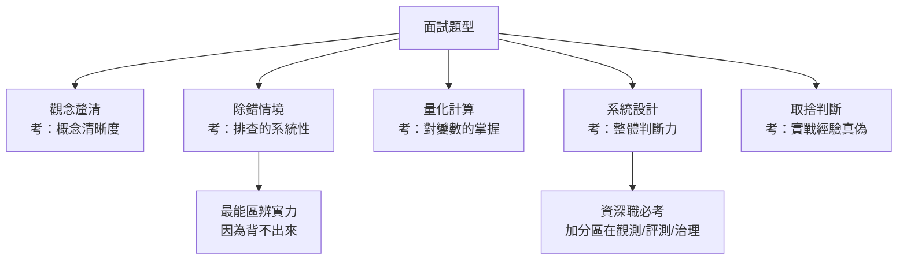

28 天的技術內容結束了。今天處理最後一哩：**怎麼讓別人相信你會這些。**

這篇的內容比較「不技術」，但如果你的目標是轉職或升遷，它可能是投報率最高的一天。

<!-- truncate -->

## 今天要解決的問題

一個很殘酷的落差：

> **你的履歷寫**：熟悉 MLOps、RAG、Agent、LangChain、Kubernetes、vLLM……
> **面試官心裡想**：這些字每份履歷都有。**你到底做過什麼？**

技術清單已經失去區辨力了。因為工具會變、關鍵字誰都能寫，而**面試官真正要判斷的是：你遇到問題時的思考方式**。

今天給三樣工具：**一份能自我定位的檢核表**、**面試最常考的五類題目與答題框架**、**一份會被記住的作品集寫法**。

> 📊 **職缺訊號**
>
> 回顧全系列的任務訊號分布——它其實就是一份**面試考古題的機率分布**：MLOps 面試最可能問平臺與部署（58.5%／49.2%），生成式 AI 面試最可能問 RAG 與 Agent（48.1%／47.6%）。**準備的優先順序，應該照這個比例分配。**

---

## 一、現象：自我檢核——你在哪個位置

先誠實定位。下面每一項，標準是「**能對非本領域的同事講清楚，並動手做出來**」：

```text
【共同地基】
□ 能寫 multi-stage Dockerfile，並說明分層順序為何影響建置速度      （Day 05）
□ 能說出「可重現」需要哪五個要素                                    （Day 05-06）
□ 能估算一次 LLM 請求的成本組成，並指出最貴的一段                   （Day 07）

【主軸一 MLOps／LLMOps】
□ 能診斷團隊的 MLOps 成熟度，並提出下一步該補哪一格                （Day 08）
□ 能用 DVC 版本化資料，並說明「訓練—服務偏斜」怎麼發生             （Day 09）
□ 能用 MLflow 追蹤實驗、以別名機制做到「換模型不改程式碼」          （Day 10）
□ 能寫一條含品質門檻的 CI，並說明門檻的四個條件                     （Day 11）
□ 能排查 Pod 的 Pending／CrashLoopBackOff／OOMKilled 三種狀態       （Day 12）
□ 能壓測服務、讀懂 P50/P95/P99，並用它回推批次上限與機器數          （Day 13）
□ 能用 PSI 偵測漂移，並說出告警後的四步決策順序                     （Day 14）
□ 能算出雲端 vs 地端的損益平衡點，並說出 GPU 利用率的關鍵指標       （Day 15）

【主軸二 生成式 AI 應用與代理系統】
□ 能說明脈絡預算怎麼編，以及 Lost in the Middle 的工程對策          （Day 16）
□ 能實作串流 ＋ 函式呼叫，並說明「權限為何必須在執行層」            （Day 17）
□ 能說出四種切塊策略的差別，以及父子塊為何是企業文件的最佳解        （Day 18）
□ 能實作混合檢索與重排序，並說明各自解決什麼失敗                    （Day 19）
□ 能建含拒答題的評測集，並分別量測檢索端與生成端                    （Day 20）
□ 能說明工作流與代理的取捨，並手刻含護欄的 ReAct 迴圈               （Day 21-22）
□ 能判斷一個需求該用微調、RAG 還是提示，並說出理由                  （Day 23）

【交會與治理】
□ 能設計 LLM-as-a-Judge 並用 κ 驗證其可信度                        （Day 24）
□ 能說明提示注入的四層防禦，並指出哪一層最有效                      （Day 25）
□ 能調校 vLLM 參數、分別對 TTFT 與 TPOT 訂 SLO                     （Day 26）
□ 能設計檢索階段的權限過濾與 audit log schema                      （Day 27）
```

**判讀**：
- 打勾 **< 8 項** → 先做 Day 28 的作品集版專題，做的過程會自然補上多數項目。
- 打勾 **8–15 項** → 具備初階至中階實力，可以開始投遞；**針對缺的項目準備說法**（誠實說「這部分我還在學，我的理解是……」遠比硬掰好）。
- 打勾 **> 15 項** → 準備資深職缺的系統設計題。

打完勾之後，把結果對照兩個職務的技能重心，看看你的形狀比較接近哪一邊：


*圖 29-1：兩職務的技能重心（依 2026-07-25 職缺任務訊號比例換算為 0–5 分的示意圖）。把你的打勾分布疊上去，就知道自己該投哪一類職缺。*

## 二、原理：面試最常考的五類題目

五類題目與它們考的能力，可以畫成一張圖：



*圖 29-2：五類面試題與各自考察的能力（示意分類）。除錯題最能區辨實力，因為它無法靠背誦通過。*


我把兩個職務的面試題歸納成五類，**每一類都有固定的答題框架**：

### 類型一：觀念釐清題

> 「MLOps 跟 DevOps 差在哪？」「RAG 跟微調怎麼選？」

**框架**：定義差異 → 舉一個具體例子 → 說出邊界（什麼時候會混用）。

**答題示範**：「差別在管理的資產：DevOps 管程式碼，MLOps 要同時管程式碼、資料、模型。舉例來說，同一份訓練程式碼，換一份資料就會產出完全不同的模型，所以需要資料版本控制——這是 DevOps 沒有的問題。當然兩者高度重疊，MLOps 的 CI/CD 基礎就是 DevOps 的實踐。」

### 類型二：除錯情境題（最能區辨實力）

> 「你的 RAG 答不出某個問題，你會怎麼查？」「Pod 一直重啟你怎麼辦？」

**框架**：**先分層二分，再逐層排除**——絕對不要一開始就猜答案。

**答題示範**：「我會先看檢索結果，判斷正確答案在不在取回的內容裡。如果不在，是檢索問題，往下查切塊、嵌入模型一致性、要不要混合檢索；如果在，是生成問題，查脈絡組裝順序、提示紀律、有沒有強制引用。**這個二分能省掉大量瞎猜。**」

> 💡 **這類題目的評分重點不是答案，是「順序」。** 面試官在看你有沒有系統性的排查習慣。

### 類型三：量化計算題

> 「8B 模型部署在 80GB 卡上，能支援多少併發？」「每天 10 萬次請求要幾張 GPU？」

**框架**：寫出公式 → 代入參數 → **講出你的假設** → 給答案與餘裕。

**答題示範**：「KV cache 是 2 × 層數 × KV head × head_dim × 位元組 × 序列長 × 批次。8B 模型大約每 token 每序列 128 KiB。權重 fp16 約 16 GB，剩 64 GB 給 KV cache 與啟動值。假設序列長 8K，那批次 16 大約要 17 GB……」

**關鍵是「講出假設」**——面試官要看的是你知道哪些變數會影響結果，而不是背下一個數字。

### 類型四：系統設計題（資深職必考）

> 「設計一個企業知識庫助理」——**你已經做過了**（Day 28）。

**框架**：需求澄清（範圍、規模、**錯誤代價**）→ 分層架構 → 深入兩層細節 → **主動講觀測、評測與治理**。

> 📌 最後那一項是最大的加分區。**多數候選人會講完架構就停**，而主動說「這個系統我會這樣監控、這樣評測、權限這樣設計」的人，會立刻被歸類為「有上線經驗」。

### 類型五：取捨判斷題

> 「什麼時候該自建推論？」「什麼時候不該用 agent？」

**框架**：給判準 → 給臨界點的數字或條件 → **講出反例**。

**答題示範**：「自建要明顯划算才做，我的門檻是省 30% 以上——因為有維運隱形成本。但有一個例外會讓成本計算失效：**資料主權**。如果法規不允許資料出境，那從第一天就得自建，不用算。」

**講出反例是最有效的加分**，因為它證明你不是在背標準答案。

## 三、動手：作品集怎麼寫才會被記住

多數作品集寫成「功能清單」，這是浪費。**改寫成「決策紀錄」**：

```markdown
## 企業知識助理（個人專題）

**問題**：查詢公司政策平均要等 HR 回覆 4 小時。

**成果**：20 題評測集上答對率 0.88、平均回應 1.2 秒、每次查詢成本約 X。

**關鍵決策與依據**：
1. **RAG 而非微調** —— 政策文件每月更新，微調的更新週期跟不上，且無法追溯來源。
2. **結構感知切塊** —— 這是提升最大的一項（答對率 0.61 → 0.79）。原本用固定 500 字元
   切塊，導致表格與條列被攔腰切斷。
3. **加了混合檢索、停在重排序** —— 混合檢索解決了法規條號查不到的問題（0.79 → 0.85），
   重排序再提升到 0.88，但延遲從 180ms 漲到 620ms。**再往上的邊際效益不划算，所以停在這裡。**
4. **權限在檢索階段過濾** —— 因為一旦無權限內容進入脈絡就等於外洩，靠提示約束不可靠。

**踩過的坑**：模型會編造不存在的引用編號 [5]，所以加了程式層的引用驗證。

**原始碼**：github.com/...（含 docker compose、評測腳本、ADR）
```

**這份寫法展示了五件事**：會量測、懂原理、有判斷力、知道何時停手、誠實面對錯誤。**技術清單一件都展示不了。**

## 四、取捨：投遞策略與誠實原則

| 情況 | 建議 |
|------|------|
| 打勾 8 項以下 | 先做專題，**別急著投**——面試機會有限，準備好再用 |
| 有一邊主軸很強、另一邊弱 | **投主軸明確的職缺**，別投「什麼都要」的萬用 JD |
| 想從資料科學轉 MLOps | 履歷強調你做過的**工程化**（部署、自動化），而非模型指標 |
| 想從後端轉生成式 AI | 強調系統整合與可靠性經驗，**這正是市場最缺的**（Day 17） |
| 完全零經驗 | Day 28 的作品集版 ＋ 誠實說明學習歷程，很多團隊願意給機會 |

> ⚠️ **一個真心的提醒：不要在履歷上寫沒做過的事**
>
> 這兩個職務的面試幾乎都會有除錯情境題與量化題，**沒做過的東西撐不過三個追問**。而被抓到誇大的代價，遠大於誠實說「這部分我還在學」。
>
> 更務實的說法是：「我在專題裡實作到 X 的程度，還沒處理過 Y 這種規模的情境，但我的理解是……」——**這種回答展示了你知道自己的邊界在哪，而這本身就是資深的特徵。**

---

## 今日小結

- 技術清單已失去區辨力，面試官真正判斷的是**你遇到問題時的思考方式**。
- 用檢核表誠實定位：標準是「能講清楚**且**做得出來」。< 8 項先做專題、8–15 項可開始投遞、> 15 項準備系統設計題。
- 五類面試題與框架：**觀念**（定義→例子→邊界）、**除錯**（先分層二分再逐層排除）、**計算**（公式→代入→**講出假設**）、**系統設計**（需求→架構→細節→**主動講觀測評測治理**）、**取捨**（判準→臨界點→**講出反例**）。
- 除錯題的評分重點是**順序**不是答案；系統設計題的最大加分是**主動談監控、評測與治理**。
- 作品集要寫成**決策紀錄**而非功能清單——展示會量測、懂原理、有判斷力、知道何時停手、誠實面對錯誤。
- **不要在履歷上寫沒做過的事**；說出自己的邊界，本身就是資深的特徵。

## 明天預告

最後一天。我會回到起點——**從職務需求談 AI 人才養成**這個主題本身，談這 30 天的資料與結論還會維持多久、2026 之後的路怎麼走，並給轉職者、在職者、教學者三張不同的路線圖。

也會誠實回顧這個系列做對與沒做好的地方。

## 延伸閱讀

- 📘 教科書對應章節：[附錄 D　職能檢核與面試題庫](https://github.com/willismax/books/blob/main/mlops-genai-agent/appendix/D-mock-interview.md)（50 題含詳解）、[附錄 F　考古題與能力鑑定實戰題庫](https://github.com/willismax/books/blob/main/mlops-genai-agent/appendix/F-past-exam-bank.md)（80 題含詳解與落點分析）
- 🔗 [2022 鐵人賽《小題大作的 30 個 HackMD 技巧》](https://ithelp.ithome.com.tw/users/20121130/ironman/5793)——把學習與專案過程寫成可搜尋的筆記，長期下來就是最好的作品集素材

---

[← Day 28](/my-site/blog/ironman-2026-day-28) ｜ [Day 30 →](/my-site/blog/ironman-2026-day-30)

> 本文同步發布於 [iThome 鐵人賽](https://ithelp.ithome.com.tw/articles/10422869)；Blog 版本為站內閱讀與系列導覽的主要版本。
